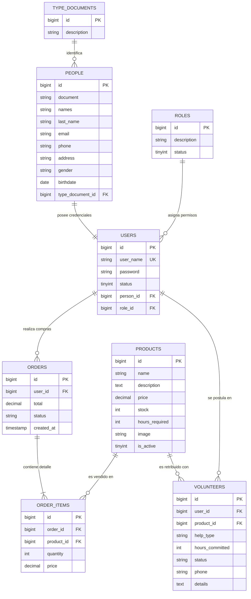

# 🗄️ Documentación de Base de Datos Relacional (MySQL)
**Proyecto Integrador:** ProductosPro - Sistema de Gestión de Inventario, Ventas y Voluntariado Solidario  
**Estudiante:** Juan Camilo Giraldo  
**Motor de Base de Datos:** MySQL 8.0 / MariaDB (InnoDB)  

---

## 1. 📋 Arquitectura y Modelo Relacional

El modelo de datos está diseñado bajo la **Tercera Forma Normal (3FN)**, garantizando integridad referencial, eliminación de redundancias y soporte para transacciones seguras mediante el motor **InnoDB**.

### 🔗 Mapa de Relaciones:
1. **`type_documents` $\rightarrow$ `people` (1 a N):** Un tipo de documento identifica a muchas personas.
2. **`people` $\rightarrow$ `users` (1 a 1):** Cada usuario registrado en el sistema está asociado a los datos personales de una persona.
3. **`roles` $\rightarrow$ `users` (1 a N):** Un rol (Admin, Cliente/Voluntario, Secretaria) puede pertenecer a múltiples usuarios.
4. **`users` $\rightarrow$ `orders` (1 a N):** Un usuario puede realizar múltiples pedidos/compras.
5. **`orders` $\leftrightarrow$ `products` a través de `order_items` (N a M):** Un pedido contiene muchos productos y un producto puede estar en múltiples pedidos, con cantidades y precios históricos fijados en el detalle.
6. **`users` $\leftrightarrow$ `products` a través de `volunteers` (1 a N en ambos extremos):** Un usuario se postula con horas de servicio comunitario para adquirir o redimir un producto específico.

---

## 2. 📊 Diagrama Entidad-Relación (DER)



---

## 3. 📑 Diccionario de Datos

| Tabla | Propósito | Llave Primaria (PK) | Llaves Foráneas (FK) |
| :--- | :--- | :--- | :--- |
| **`type_documents`** | Catálogo de tipos de documento de identidad (CC, TI, CE, Pasaporte). | `id` | Ninguna |
| **`roles`** | Gestión de perfiles y permisos de usuario (Admin, Cliente/Voluntario). | `id` | Ninguna |
| **`people`** | Información personal y de contacto de usuarios registrados. | `id` | `type_document_id` $\rightarrow$ `type_documents(id)` |
| **`users`** | Credenciales de inicio de sesión y asignación de rol en el sistema. | `id` | `person_id` $\rightarrow$ `people(id)`, `role_id` $\rightarrow$ `roles(id)` |
| **`products`** | Catálogo de productos disponibles para compra o intercambio solidario. | `id` | Ninguna |
| **`orders`** | Cabecera de transacciones de compra realizadas por los clientes. | `id` | `user_id` $\rightarrow$ `users(id)` |
| **`order_items`** | Detalle de líneas de pedido (producto, cantidad y precio unitario). | `id` | `order_id` $\rightarrow$ `orders(id)`, `product_id` $\rightarrow$ `products(id)` |
| **`volunteers`** | Solicitudes de voluntariado de usuarios a cambio de productos. | `id` | `user_id` $\rightarrow$ `users(id)`, `product_id` $\rightarrow$ `products(id)` |

---

## 4. 🔍 Consultas SQL de Demostración (Para Sustentación)

### Consulta 1: Historial de Compras con Detalles y Nombres de Productos (JOIN Múltiple)
```sql
SELECT 
    o.id AS pedido_id,
    u.user_name AS usuario,
    CONCAT(p.names, ' ', p.last_name) AS nombre_completo,
    prod.name AS producto,
    oi.quantity AS cantidad,
    oi.price AS precio_unitario,
    (oi.quantity * oi.price) AS subtotal,
    o.total AS total_pedido,
    o.created_at AS fecha_compra
FROM orders o
INNER JOIN users u ON o.user_id = u.id
INNER JOIN people p ON u.person_id = p.id
INNER JOIN order_items oi ON o.id = oi.order_id
INNER JOIN products prod ON oi.product_id = prod.id
ORDER BY o.id DESC;
```

### Consulta 2: Reporte de Voluntarios con Producto Postulado y Horas
```sql
SELECT 
    v.id AS postulacion_id,
    u.user_name AS voluntario,
    p.phone AS telefono_contacto,
    prod.name AS producto_solicitado,
    prod.hours_required AS horas_requeridas,
    v.help_type AS labor_ofrecida,
    v.hours_committed AS horas_comprometidas,
    v.status AS estado_postulacion
FROM volunteers v
INNER JOIN users u ON v.user_id = u.id
INNER JOIN people p ON u.person_id = p.id
INNER JOIN products prod ON v.product_id = prod.id;
```

---

## 5. 🚀 Cómo importar la Base de Datos en MySQL / Laragon

### Opción A: Mediante phpMyAdmin / HeidiSQL
1. Abre **Laragon** y presiona **"Iniciar todo"** (Start All).
2. Entra a phpMyAdmin (`http://localhost/phpmyadmin`).
3. Ve a la pestaña **"Importar"**.
4. Selecciona el archivo: `database/entrega_mysql_completa.sql`.
5. Clic en **"Continuar"**. Se creará la base de datos `laravel` con todas sus tablas, restricciones y datos de prueba.

### Opción B: Mediante Laravel Artisan
```bash
php artisan migrate:fresh --seed
```
Este comando ejecutará todas las migraciones y el seeder actualizado con los mismos datos reales.
